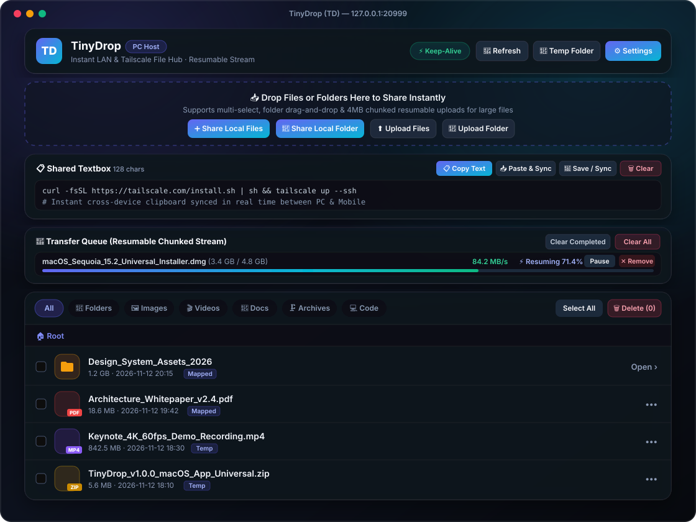

<div align="center">
  
  <h1>TinyDrop (TD)</h1>
  <p><strong>Ultra-lightweight cross-platform LAN & Tailscale file sharing utility with resumable chunked streaming.</strong></p>
  <p>
    <a href="https://github.com/tim-today/TinyDrop/releases"></a>
    
    
    
  </p>
</div>

<p align="center">
  
</p>

---

## ✨ Key Features

- **🖥️ Native System Tray GUI (macOS & Windows)**
  Lives quietly in your macOS menu bar or Windows system tray with a custom **TD** icon. Quickly open the dashboard, reveal the temporary share directory in Finder/Explorer, add files/folders via native OS dialogs, toggle sharing, or reset the access PIN.
- **🌐 Auto LAN & Tailscale Discovery + QR Instant Connect**
  Automatically detects local private LAN IPs (`192.168.x.x` / `10.x.x.x`) and **Tailscale virtual IPs (`100.64.0.0/10`)**. Switch network interfaces with one click to generate an offline SVG QR code for instant mobile browser access.
- **🔐 6-Digit PIN Auth & Persistent Client Sessions**
  Protects shared files with a 6-digit PIN code generated by default. Once a mobile or desktop browser authenticates, its session token remains valid automatically as long as the host does not change the PIN.
- **🛡️ Granular Read / Write Permissions**
  Defaults to **Read-Only** mode for external clients. When **Allow Client Upload & Delete** is enabled, connected H5 clients gain full management capabilities (upload files/folders, batch select, and delete).
- **🔗 Dual Share Modes: Zero-Copy Mapping & Copy Archive**
  - **Zero-Copy Path Mapping (`map`)**: Shares files or large directories directly from their original disk locations without copying or consuming extra disk space. Removing a mapped item only unshares it without deleting your source file.
  - **Copy Archive Mode (`copy`)**: Copies selected files into the configured local temporary share folder.
- **📋 Shared Textbox (Cross-Device Clipboard)**
  Built-in synchronized text pad for sharing long text, URLs, code snippets, or terminal commands between PC and mobile devices with one-click copy and paste.
- **🚀 Large-File Friendly: 4MB Chunked Resumable Uploads**
  Streams multi-gigabyte files in `4MB` chunks with real-time progress bars, transfer speed (`MB/s`), pause/resume controls, and task cleanup. Interrupted uploads automatically resume from the exact byte offset on retry. Folders can be downloaded on the fly as streamed `.zip` archives.
- **📱 Responsive Mobile H5 & Rich File Type Icons**
  Designed with a sleek dark glassmorphism UI and a mobile-first single-column layout that maximizes space for long file names. Tapping any file opens a detail confirmation sheet before downloading.
- **⚡ Auto Keep-Alive Watchdog**
  Listens on port `20999` by default (customizable in real time via UI or CLI) with a built-in HTTP heartbeat watchdog and optional `-guard` process supervisor to prevent service drops.

---

## 🚀 Quick Start

### 1. Download Prebuilt Binaries

Download the latest release for **macOS** (`TinyDrop.app` Universal), **Windows** (`TinyDrop.exe` GUI Tray), or **Linux** from the [Releases](https://github.com/tim-today/TinyDrop/releases) page.

### 2. Run from Source or CLI

```bash
git clone https://github.com/tim-today/TinyDrop.git
cd TinyDrop

# Build and run
go build -o tinydrop .
./tinydrop

# Optional flags: custom port, process supervisor guard, or headless startup
./tinydrop -port 20999 -guard -no-browser
```

---

## 📄 License

MIT License © [tim-today](https://github.com/tim-today/TinyDrop)
